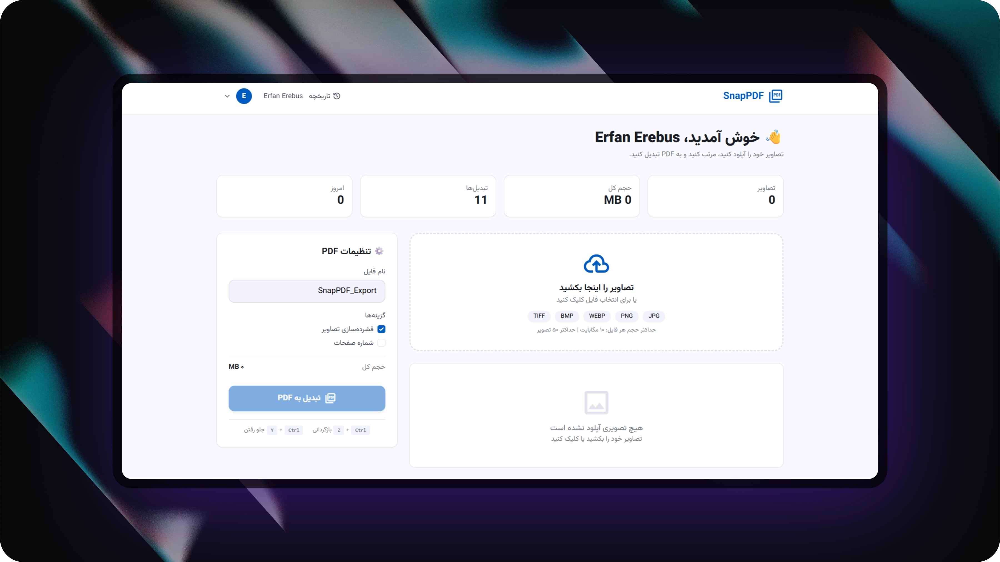
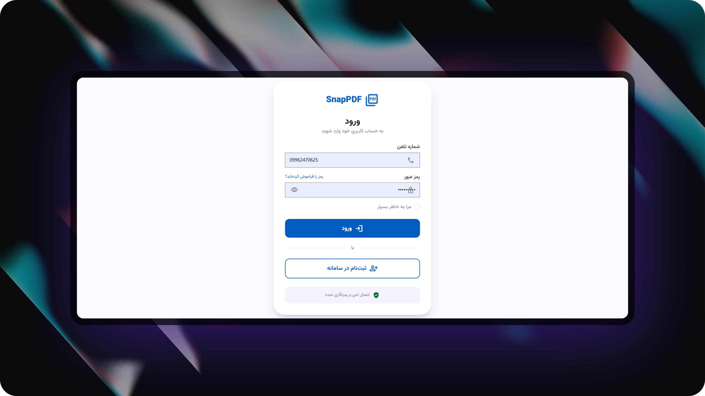

## 📄 **پروژه SnapPDF**

```markdown
# 📄 SnapPDF - تبدیل آنلاین تصاویر به PDF

[](https://php.net)
[](https://codeigniter.com)
[](LICENSE)

## 📌 معرفی پروژه

**SnapPDF** یک پلتفرم تحت وب برای تبدیل سریع و آسان تصاویر به فایل PDF است. کاربران می‌توانند تصاویر خود را آپلود کرده، اولویت‌بندی (مرتب‌سازی) کنند و در نهایت یک فایل PDF با کیفیت بالا دریافت نمایند. تمام فایل‌ها پس از ۲ دقیقه به‌صورت خودکار از سرور حذف می‌شوند.

### ✨ ویژگی‌های اصلی

- 🔐 **احراز هویت امن** با شماره تلفن و کد یکبارمصرف (OTP) از طریق سرویس **بله**
- 📤 **آپلود تصاویر** با کشیدن و رها کردن (Drag & Drop)
- 🔄 **اولویت‌بندی تصاویر** با قابلیت کشیدن و جابجایی (Sortable)
- 📄 **تبدیل به PDF** با کیفیت بالا
- ⏱️ **حذف خودکار فایل‌ها** پس از ۲ دقیقه
- 📱 **طراحی کاملاً ریسپانسیو** (موبایل-فرست)
- 🎨 **رابط کاربری مدرن و مینیمال**
- 📊 **تاریخچه تبدیل‌ها** و آمار کاربری

---

## 🛠️ تکنولوژی‌های استفاده شده

| بخش | تکنولوژی |
|-----|----------|
| **Backend** | PHP 8.1+ / CodeIgniter 4.7.3 |
| **Database** | MySQL / MariaDB |
| **Frontend** | HTML5, CSS3, TailwindCSS, JavaScript |
| **Drag & Drop** | SortableJS |
| **PDF Generator** | Dompdf |
| **SMS Service** | بله (Bale) - سرویس سفیر |
| **Icons** | Material Symbols |

---

## 🚀 نصب و راه‌اندازی

### 1️⃣ پیش‌نیازها

- PHP 8.1 یا بالاتر
- MySQL 5.7 یا بالاتر
- Composer
- Web Server (Apache / Nginx)

### 2️⃣ کلون کردن پروژه

```bash
git clone https://github.com/yourusername/snappdf.git
cd snappdf
```

### 3️⃣ نصب وابستگی‌ها

```bash
composer install
```

### 4️⃣ تنظیمات محیطی

```bash
cp .env.example .env
```

فایل `.env` را ویرایش کنید:

```env
# Database
database.default.hostname = localhost
database.default.database = snappdf_db
database.default.username = root
database.default.password = 

# Base URL
app.baseURL = 'http://localhost/snappdf/'

# Bale SMS Service
BALE_API_KEY = your_api_key
BALE_BOT_ID = your_bot_id
```

### 5️⃣ ایجاد دیتابیس

```sql
CREATE DATABASE IF NOT EXISTS snappdf_db CHARACTER SET utf8mb4 COLLATE utf8mb4_unicode_ci;
```

سپس جداول را ایجاد کنید (فایل `database.sql` در ریشه پروژه موجود است).

### 6️⃣ تنظیم دسترسی‌ها

```bash
chmod -R 777 writable/uploads/
```

### 7️⃣ اجرای پروژه

#### با PHP Built-in Server:

```bash
php spark serve
```

#### با Apache/XAMPP/Mamp:

پروژه را در `htdocs` قرار دهید و از آدرس زیر باز کنید:

```
http://localhost/snappdf/public/
```

---

## 📊 دیتابیس

### جداول اصلی

| جدول | توضیح |
|------|-------|
| `users` | اطلاعات کاربران |
| `otp_logs` | لاگ‌های کد یکبارمصرف |
| `temp_files` | فایل‌های موقت آپلود شده |
| `conversions` | تاریخچه تبدیل‌ها |
| `failed_attempts` | تلاش‌های ناموفق |

---

## 🔐 احراز هویت

### جریان ثبت‌نام

1. کاربر شماره تلفن را وارد می‌کند
2. کد OTP به شماره ارسال می‌شود (سرویس بله)
3. کاربر کد را تأیید می‌کند
4. اطلاعات تکمیلی (نام، رمز عبور) ثبت می‌شود
5. ورود خودکار به سیستم

### جریان ورود

1. کاربر شماره تلفن و رمز عبور را وارد می‌کند
2. بررسی اعتبار اطلاعات
3. اگر شماره تأیید نشده باشد، کد OTP ارسال می‌شود
4. ورود موفق به داشبورد

---

## 📤 تبدیل تصاویر به PDF

### مراحل تبدیل

1. **آپلود**: کشیدن یا انتخاب تصاویر (JPG, PNG, WEBP, BMP, TIFF)
2. **مرتب‌سازی**: جابجایی تصاویر با کشیدن یا دکمه‌های بالا/پایین
3. **تنظیمات**: نام فایل، فشرده‌سازی، شماره صفحات
4. **تبدیل**: کلیک روی دکمه تبدیل
5. **دانلود**: دریافت فایل PDF
6. **حذف خودکار**: فایل پس از ۲ دقیقه حذف می‌شود

### میانبرهای صفحه کلید

| کلید ترکیبی | عملکرد |
|------------|---------|
| `Ctrl+Z` | بازگردانی (Undo) |
| `Ctrl+Y` | جلو رفتن (Redo) |

---

## 📱 پاسخگویی (Responsive)

پروژه به‌صورت کامل برای دستگاه‌های مختلف بهینه‌سازی شده است:

| دستگاه | Breakpoint |
|--------|------------|
| **موبایل** | < 768px |
| **تبلت** | 768px - 1024px |
| **دسکتاپ** | > 1024px |

---

## 🔧 عیب‌یابی (Troubleshooting)

### خطای `setBind(): Argument #1 ($key) must be of type string`

این خطا مربوط به مدل‌هاست. مطمئن شوید که در متدهای `insert` و `update` از آرایه‌هایی با **کلیدهای رشته‌ای** استفاده می‌کنید.

### خطای 404 برای مسیرها

1. فایل `public/.htaccess` را بررسی کنید
2. مطمئن شوید `baseURL` در `app/Config/App.php` درست تنظیم شده است
3. با دستور `php spark routes` مسیرها را بررسی کنید

### پیامک ارسال نمی‌شود

1. کلید API و Bot ID را بررسی کنید
2. مطمئن شوید سرویس بله فعال است
3. فایل لاگ `writable/logs/` را بررسی کنید

---

## 📸 تصاویر پروژه

صفحه ورودی پروژه با طراحی جذاب و معرفی امکانات.


### صفحه داشبورد



### صفحه ورود




---

## 📝 مجوز

این پروژه تحت مجوز **MIT** منتشر شده است. برای اطلاعات بیشتر فایل `LICENSE` را مشاهده کنید.

---

## ⭐ حمایت

اگر پروژه برای شما مفید بود، لطفاً به آن **Star** دهید ⭐

---

## 📞 تماس

- **وب‌سایت**: [https://snappdf.com](https://ebarqak.ir)
- **ایمیل پشتیبانی**: erfanerebus@gmail.com
- **تلگرام**: [@snappdf](https://t.me/erfanerebus)

---

**SnapPDF** - تبدیل سریع و امن تصاویر به PDF 🚀